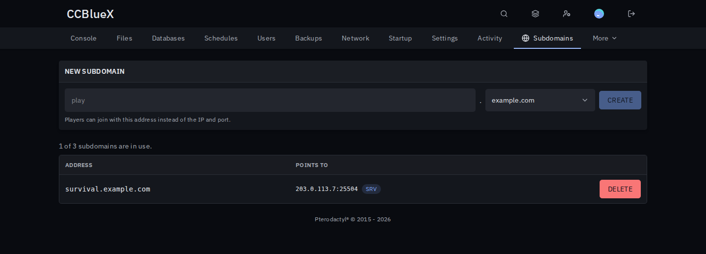
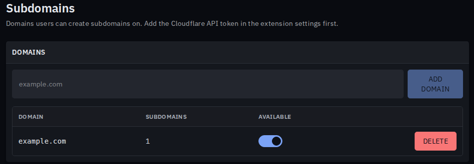

# Subdomains for Pterodactyl

Let users give their servers a name like `play.example.com`, on your Cloudflare domains.

## Install

1. Download `subdomains-<version>.pteroext` from the [latest release](https://github.com/1zun4/Pterodactyl-Extension-Subdomains/releases/latest), then install and enable it under **Admin → Extensions**.
2. Create a Cloudflare API token with **Zone: Read** and **DNS: Edit** and paste it into the extension's settings.
3. Add your domains under **Admin → Subdomains**.

## Features

- **Self-service**: users create and delete subdomains on the server's **Subdomains** tab.
- **Minecraft SRV**: Minecraft servers on other ports than 25565 get an SRV record, so players join without a port.
- **Limits**: a default per server, changeable on each server's admin page.
- **Stays correct**: records follow allocation changes and disappear when the server is deleted.
- **Reserved names**: keep names like `www` or `mail` for yourself.

## Permissions

Subusers get a **Subdomains** group in the server's **Users** tab: see and manage subdomains.

---

Inspired by the Pelican plugins Subdomains and MC-HOST24 Subdomains.
