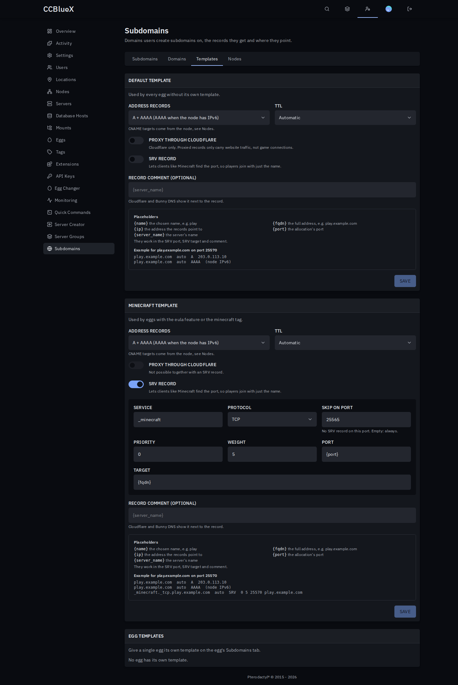

# Subdomains for Pterodactyl

Let users give their servers a name like `play.example.com`, on your Cloudflare, Bunny DNS or PowerDNS domains.

## Install

1. Download `subdomains-<version>.pteroext` from the [latest release](https://github.com/CCBlueX/Pterodactyl-Extension-Subdomains/releases/latest), then install and enable it under **Admin → Extensions**.
2. Under **Admin → Subdomains → Domains**, add a domain or a range (`serv.example.com` in the zone `example.com`) with its DNS provider's API token and click **Test connection**.
3. Optional: pick how names are chosen, which eggs may use it and adjust the record templates.

## Features

- **Self-service**: users create, rename, re-point and delete subdomains, pick the allocation and add a note.
- **Ranges and naming rules**: give out `<name>.serv.example.com` below any zone. Per domain, users type the name, get one from a pattern like `{username}-{server}`, or a random one.
- **Record templates**: A, AAAA or CNAME plus optional SRV with placeholders, per egg. Minecraft gets its SRV record out of the box.
- **Three DNS providers**: Cloudflare, Bunny DNS and PowerDNS, with encrypted credentials per domain.
- **You stay in control, it stays correct**: limits per server, reserved names, eggs per domain and an overview of every subdomain. Records follow allocation and template changes and disappear with the server.

## Permissions

Subusers get a **Subdomains** group in the server's **Users** tab: see, create, change (rename, re-point, note) and delete. Renaming only works on domains where users type the name. The older "manage" permission still covers all three changes.

---

Inspired by the Pelican plugins Subdomains and MC-HOST24 Subdomains.
